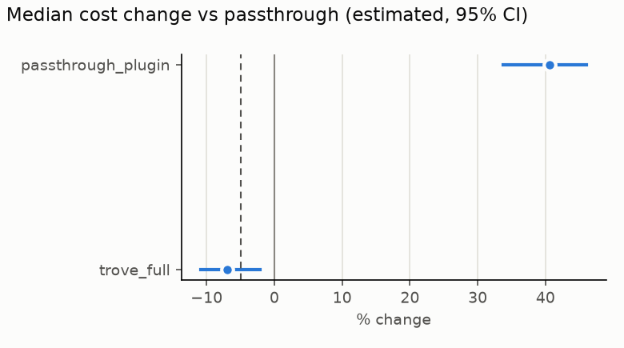
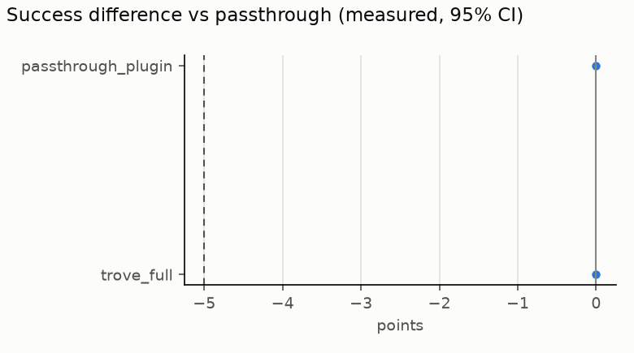
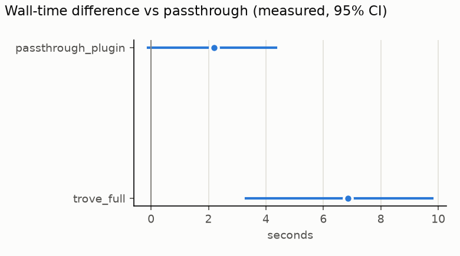

# Long Sonnet sessions: no optimization vs the Trove plugin vs the plugin + gateway + routing

Study `launch-1` · agent `claude_code` · model `claude-sonnet-5-5` · 30 task(s) · 270 run(s)

## Pre-registration

- Hypothesis: On long Claude Code sessions with Sonnet, the Trove plugin alone lowers the billed cost per session, and the plugin with the gateway and model routing lowers it further, in both cases without lowering the share of tasks that pass.

- Primary metric: `billed_cost_usd`; baseline: `passthrough`; conditions: `passthrough`, `passthrough_plugin`, `trove_full`
- Efforts: model default only; repeats: 3; order seed: 20261118
- Locked 2026-11-18T14:34:00+00:00 at commit `b1cf19f0a4`, file hash `40d12e203919`. Every comparison below was registered before the first run; anything added afterwards is marked exploratory.

**How to read the numbers.** Pass/fail, wall time and token counts are *measured*. Cost is *estimated*: list price applied to the token counts the agent itself reported, using the same source for every condition (`recorded` basis). It is not an invoice. Cost changes are the median of per-pair changes against the baseline, with a bootstrap interval that resamples whole tasks, because repeats of one task are not independent.

## Decisions

Rule: ship only if, over at least **30** pairs against `passthrough`, the 98% interval of the cost change is entirely at or below **-5%**, success does not fall by more than **5 points** (interval lower bound), and the primary p-value is below **0.0166667** after Holm correction.

| Condition | Pairs | Median cost change, est. (CI) | Success diff, pts (CI) | Median latency diff | p (primary, adj.) | Verdict |
|---|---:|---|---|---|---|---|
| `passthrough_plugin` | 90 | +40.6% (+33.7%, +46.1%) | +0.0 (+0.0, +0.0) | +2.2s (-0.1s, +4.4s) | 0.000, 0.000 | NEED MORE DATA |
| `trove_full` | 90 | -7.0% (-10.8%, -2.1%) | +0.0 (+0.0, +0.0) | +6.9s (+3.3s, +9.8s) | 0.001, 0.001 | NEED MORE DATA |

- `passthrough_plugin`: The confidence intervals still straddle a threshold; more paired runs are needed.
- `trove_full`: The confidence intervals still straddle a threshold; more paired runs are needed.

## Per condition

| Condition | Runs | Excluded | Mean cost (est.) | Median cost (est.) | Success rate (95% CI) |
|---|---:|---:|---:|---:|---|
| `passthrough` | 90 | 0 | $0.1065 | $0.0884 | 100% (100%, 100%) |
| `passthrough_plugin` | 90 | 0 | $0.1264 | $0.1210 | 100% (100%, 100%) |
| `trove_full` | 90 | 0 | $0.0881 | $0.0833 | 100% (100%, 100%) |

## Charts







## Data quality

| Run | Status | Note |
|---|---|---|
| long-py-affine-cipher__trove_full__s0 | ok | agent's own cost estimate differs from the gateway's by 131% |
| long-py-affine-cipher__trove_full__s1 | ok | agent's own cost estimate differs from the gateway's by 161% |
| long-py-affine-cipher__trove_full__s2 | ok | agent's own cost estimate differs from the gateway's by 208% |
| long-py-beer-song__trove_full__s0 | ok | agent's own cost estimate differs from the gateway's by 202% |
| long-py-beer-song__trove_full__s1 | ok | agent's own cost estimate differs from the gateway's by 213% |
| long-py-beer-song__trove_full__s2 | ok | agent's own cost estimate differs from the gateway's by 179% |
| long-py-bottle-song__trove_full__s0 | ok | agent's own cost estimate differs from the gateway's by 179% |
| long-py-bottle-song__trove_full__s1 | ok | agent's own cost estimate differs from the gateway's by 221% |
| long-py-bottle-song__trove_full__s2 | ok | agent's own cost estimate differs from the gateway's by 189% |
| long-py-bowling__trove_full__s0 | ok | agent's own cost estimate differs from the gateway's by 305% |
| long-py-bowling__trove_full__s1 | ok | agent's own cost estimate differs from the gateway's by 238% |
| long-py-bowling__trove_full__s2 | ok | agent's own cost estimate differs from the gateway's by 303% |
| long-py-connect__trove_full__s0 | ok | agent's own cost estimate differs from the gateway's by 165% |
| long-py-connect__trove_full__s1 | ok | agent's own cost estimate differs from the gateway's by 191% |
| long-py-connect__trove_full__s2 | ok | agent's own cost estimate differs from the gateway's by 191% |
| long-py-dominoes__trove_full__s0 | ok | agent's own cost estimate differs from the gateway's by 157% |
| long-py-dominoes__trove_full__s1 | ok | agent's own cost estimate differs from the gateway's by 155% |
| long-py-dominoes__trove_full__s2 | ok | agent's own cost estimate differs from the gateway's by 173% |
| long-py-dot-dsl__trove_full__s0 | ok | agent's own cost estimate differs from the gateway's by 216% |
| long-py-dot-dsl__trove_full__s1 | ok | agent's own cost estimate differs from the gateway's by 200% |
| long-py-dot-dsl__trove_full__s2 | ok | agent's own cost estimate differs from the gateway's by 180% |
| long-py-food-chain__trove_full__s0 | ok | agent's own cost estimate differs from the gateway's by 221% |
| long-py-food-chain__trove_full__s1 | ok | agent's own cost estimate differs from the gateway's by 222% |
| long-py-food-chain__trove_full__s2 | ok | agent's own cost estimate differs from the gateway's by 241% |
| long-py-forth__trove_full__s0 | ok | agent's own cost estimate differs from the gateway's by 209% |
| long-py-forth__trove_full__s1 | ok | agent's own cost estimate differs from the gateway's by 255% |
| long-py-forth__trove_full__s2 | ok | agent's own cost estimate differs from the gateway's by 191% |
| long-py-go-counting__trove_full__s0 | ok | agent's own cost estimate differs from the gateway's by 204% |
| long-py-go-counting__trove_full__s1 | ok | agent's own cost estimate differs from the gateway's by 248% |
| long-py-go-counting__trove_full__s2 | ok | agent's own cost estimate differs from the gateway's by 215% |
| long-py-grade-school__trove_full__s0 | ok | agent's own cost estimate differs from the gateway's by 133% |
| long-py-grade-school__trove_full__s1 | ok | agent's own cost estimate differs from the gateway's by 153% |
| long-py-grade-school__trove_full__s2 | ok | agent's own cost estimate differs from the gateway's by 128% |
| long-py-grep__trove_full__s0 | ok | agent's own cost estimate differs from the gateway's by 171% |
| long-py-grep__trove_full__s1 | ok | agent's own cost estimate differs from the gateway's by 135% |
| long-py-grep__trove_full__s2 | ok | agent's own cost estimate differs from the gateway's by 151% |
| long-py-hangman__trove_full__s0 | ok | agent's own cost estimate differs from the gateway's by 170% |
| long-py-hangman__trove_full__s1 | ok | agent's own cost estimate differs from the gateway's by 186% |
| long-py-hangman__trove_full__s2 | ok | agent's own cost estimate differs from the gateway's by 181% |
| long-py-paasio__trove_full__s0 | ok | agent's own cost estimate differs from the gateway's by 178% |
| long-py-paasio__trove_full__s1 | ok | agent's own cost estimate differs from the gateway's by 226% |
| long-py-paasio__trove_full__s2 | ok | agent's own cost estimate differs from the gateway's by 223% |
| long-py-phone-number__trove_full__s0 | ok | agent's own cost estimate differs from the gateway's by 238% |
| long-py-phone-number__trove_full__s1 | ok | agent's own cost estimate differs from the gateway's by 204% |
| long-py-phone-number__trove_full__s2 | ok | agent's own cost estimate differs from the gateway's by 195% |
| long-py-pig-latin__trove_full__s0 | ok | agent's own cost estimate differs from the gateway's by 188% |
| long-py-pig-latin__trove_full__s1 | ok | agent's own cost estimate differs from the gateway's by 223% |
| long-py-pig-latin__trove_full__s2 | ok | agent's own cost estimate differs from the gateway's by 220% |
| long-py-poker__trove_full__s0 | ok | agent's own cost estimate differs from the gateway's by 207% |
| long-py-poker__trove_full__s1 | ok | agent's own cost estimate differs from the gateway's by 238% |
| long-py-poker__trove_full__s2 | ok | agent's own cost estimate differs from the gateway's by 228% |
| long-py-pov__trove_full__s0 | ok | agent's own cost estimate differs from the gateway's by 196% |
| long-py-pov__trove_full__s1 | ok | agent's own cost estimate differs from the gateway's by 219% |
| long-py-pov__trove_full__s2 | ok | agent's own cost estimate differs from the gateway's by 204% |
| long-py-react__trove_full__s0 | ok | agent's own cost estimate differs from the gateway's by 235% |
| long-py-react__trove_full__s1 | ok | agent's own cost estimate differs from the gateway's by 171% |
| long-py-react__trove_full__s2 | ok | agent's own cost estimate differs from the gateway's by 168% |
| long-py-rest-api__trove_full__s0 | ok | agent's own cost estimate differs from the gateway's by 152% |
| long-py-rest-api__trove_full__s1 | ok | agent's own cost estimate differs from the gateway's by 173% |
| long-py-rest-api__trove_full__s2 | ok | agent's own cost estimate differs from the gateway's by 183% |
| long-py-robot-name__trove_full__s0 | ok | agent's own cost estimate differs from the gateway's by 243% |
| long-py-robot-name__trove_full__s1 | ok | agent's own cost estimate differs from the gateway's by 173% |
| long-py-robot-name__trove_full__s2 | ok | agent's own cost estimate differs from the gateway's by 208% |
| long-py-scale-generator__trove_full__s0 | ok | agent's own cost estimate differs from the gateway's by 213% |
| long-py-scale-generator__trove_full__s1 | ok | agent's own cost estimate differs from the gateway's by 201% |
| long-py-scale-generator__trove_full__s2 | ok | agent's own cost estimate differs from the gateway's by 213% |
| long-py-sgf-parsing__trove_full__s0 | ok | agent's own cost estimate differs from the gateway's by 211% |
| long-py-sgf-parsing__trove_full__s1 | ok | agent's own cost estimate differs from the gateway's by 198% |
| long-py-sgf-parsing__trove_full__s2 | ok | agent's own cost estimate differs from the gateway's by 225% |
| long-py-transpose__trove_full__s0 | ok | agent's own cost estimate differs from the gateway's by 211% |
| long-py-transpose__trove_full__s1 | ok | agent's own cost estimate differs from the gateway's by 213% |
| long-py-transpose__trove_full__s2 | ok | agent's own cost estimate differs from the gateway's by 207% |
| long-py-tree-building__trove_full__s0 | ok | agent's own cost estimate differs from the gateway's by 279% |
| long-py-tree-building__trove_full__s1 | ok | agent's own cost estimate differs from the gateway's by 206% |
| long-py-tree-building__trove_full__s2 | ok | agent's own cost estimate differs from the gateway's by 218% |
| long-py-two-bucket__trove_full__s0 | ok | agent's own cost estimate differs from the gateway's by 161% |
| long-py-two-bucket__trove_full__s1 | ok | agent's own cost estimate differs from the gateway's by 255% |
| long-py-two-bucket__trove_full__s2 | ok | agent's own cost estimate differs from the gateway's by 209% |
| long-py-variable-length-quantity__trove_full__s0 | ok | agent's own cost estimate differs from the gateway's by 175% |
| long-py-variable-length-quantity__trove_full__s1 | ok | agent's own cost estimate differs from the gateway's by 164% |
| long-py-variable-length-quantity__trove_full__s2 | ok | agent's own cost estimate differs from the gateway's by 158% |
| long-py-wordy__trove_full__s0 | ok | agent's own cost estimate differs from the gateway's by 178% |
| long-py-wordy__trove_full__s1 | ok | agent's own cost estimate differs from the gateway's by 200% |
| long-py-wordy__trove_full__s2 | ok | agent's own cost estimate differs from the gateway's by 335% |
| long-py-zebra-puzzle__trove_full__s0 | ok | agent's own cost estimate differs from the gateway's by 242% |
| long-py-zebra-puzzle__trove_full__s1 | ok | agent's own cost estimate differs from the gateway's by 247% |
| long-py-zebra-puzzle__trove_full__s2 | ok | agent's own cost estimate differs from the gateway's by 318% |
| long-py-zipper__trove_full__s0 | ok | agent's own cost estimate differs from the gateway's by 187% |
| long-py-zipper__trove_full__s1 | ok | agent's own cost estimate differs from the gateway's by 151% |
| long-py-zipper__trove_full__s2 | ok | agent's own cost estimate differs from the gateway's by 180% |

## Versions (pinned for reproduction)

```json
{
  "agent": "claude_code",
  "agent_version_pinned": "2.1.319",
  "agent_version_reported": "2.1.319 (Claude Code)",
  "config_sha256": "6b03a0bcd5624161aed0c7adc4e679040a0d48af35ee72b17e72273b1628bbb9",
  "dataset_commits": [
    "7e0611e77b54e2dea774cdc0aa00cf9f7ed6144f"
  ],
  "docker_arch": "amd64",
  "fake_agent": false,
  "image_ids": {
    "long-py-affine-cipher": "sha256:8d580bb6c0a6bca5d471bd652a08c7d12d910f896752527fc798da762b5a891a",
    "long-py-beer-song": "sha256:8d580bb6c0a6bca5d471bd652a08c7d12d910f896752527fc798da762b5a891a",
    "long-py-bottle-song": "sha256:8d580bb6c0a6bca5d471bd652a08c7d12d910f896752527fc798da762b5a891a",
    "long-py-bowling": "sha256:8d580bb6c0a6bca5d471bd652a08c7d12d910f896752527fc798da762b5a891a",
    "long-py-connect": "sha256:8d580bb6c0a6bca5d471bd652a08c7d12d910f896752527fc798da762b5a891a",
    "long-py-dominoes": "sha256:8d580bb6c0a6bca5d471bd652a08c7d12d910f896752527fc798da762b5a891a",
    "long-py-dot-dsl": "sha256:8d580bb6c0a6bca5d471bd652a08c7d12d910f896752527fc798da762b5a891a",
    "long-py-food-chain": "sha256:8d580bb6c0a6bca5d471bd652a08c7d12d910f896752527fc798da762b5a891a",
    "long-py-forth": "sha256:8d580bb6c0a6bca5d471bd652a08c7d12d910f896752527fc798da762b5a891a",
    "long-py-go-counting": "sha256:8d580bb6c0a6bca5d471bd652a08c7d12d910f896752527fc798da762b5a891a",
    "long-py-grade-school": "sha256:8d580bb6c0a6bca5d471bd652a08c7d12d910f896752527fc798da762b5a891a",
    "long-py-grep": "sha256:8d580bb6c0a6bca5d471bd652a08c7d12d910f896752527fc798da762b5a891a",
    "long-py-hangman": "sha256:8d580bb6c0a6bca5d471bd652a08c7d12d910f896752527fc798da762b5a891a",
    "long-py-paasio": "sha256:8d580bb6c0a6bca5d471bd652a08c7d12d910f896752527fc798da762b5a891a",
    "long-py-phone-number": "sha256:8d580bb6c0a6bca5d471bd652a08c7d12d910f896752527fc798da762b5a891a",
    "long-py-pig-latin": "sha256:8d580bb6c0a6bca5d471bd652a08c7d12d910f896752527fc798da762b5a891a",
    "long-py-poker": "sha256:8d580bb6c0a6bca5d471bd652a08c7d12d910f896752527fc798da762b5a891a",
    "long-py-pov": "sha256:8d580bb6c0a6bca5d471bd652a08c7d12d910f896752527fc798da762b5a891a",
    "long-py-react": "sha256:8d580bb6c0a6bca5d471bd652a08c7d12d910f896752527fc798da762b5a891a",
    "long-py-rest-api": "sha256:8d580bb6c0a6bca5d471bd652a08c7d12d910f896752527fc798da762b5a891a",
    "long-py-robot-name": "sha256:8d580bb6c0a6bca5d471bd652a08c7d12d910f896752527fc798da762b5a891a",
    "long-py-scale-generator": "sha256:8d580bb6c0a6bca5d471bd652a08c7d12d910f896752527fc798da762b5a891a",
    "long-py-sgf-parsing": "sha256:8d580bb6c0a6bca5d471bd652a08c7d12d910f896752527fc798da762b5a891a",
    "long-py-transpose": "sha256:8d580bb6c0a6bca5d471bd652a08c7d12d910f896752527fc798da762b5a891a",
    "long-py-tree-building": "sha256:8d580bb6c0a6bca5d471bd652a08c7d12d910f896752527fc798da762b5a891a",
    "long-py-two-bucket": "sha256:8d580bb6c0a6bca5d471bd652a08c7d12d910f896752527fc798da762b5a891a",
    "long-py-variable-length-quantity": "sha256:8d580bb6c0a6bca5d471bd652a08c7d12d910f896752527fc798da762b5a891a",
    "long-py-wordy": "sha256:8d580bb6c0a6bca5d471bd652a08c7d12d910f896752527fc798da762b5a891a",
    "long-py-zebra-puzzle": "sha256:8d580bb6c0a6bca5d471bd652a08c7d12d910f896752527fc798da762b5a891a",
    "long-py-zipper": "sha256:8d580bb6c0a6bca5d471bd652a08c7d12d910f896752527fc798da762b5a891a"
  },
  "model": "claude-sonnet-5-5",
  "pricing_data_version": "2026-11-12.1",
  "trove_binary_sha256": "89b7c646c74b132bb3c9d03e3c5f221855ab5a6692b7f23898a834db8bc4afee",
  "trove_commit": "f51f37d6995793de4922da4e3f435d5c8d8b1b29",
  "trove_dirty": false
}
```

## Data use

Transcripts of these runs, if kept, are for analysis and debugging only. No model is trained on anything produced by these runs. Task content belongs to its upstream projects (see `bench/LICENSES.md`); this report publishes only task IDs and aggregates.

## Correction (added 2026-11-18, after the results; numbers and verdicts above are unchanged)

- **The plugin comparison is confounded.** `passthrough` ran Claude Code with `--bare`; `passthrough_plugin` and
  `trove_full` could not, because plugins and hooks do not load in bare mode. Bare mode gives Claude only Bash, file
  read and file edit and leaves out Claude Code's system reminders and skills list (code.claude.com/docs/en/headless,
  checked 2026-11-18). So the treated arms also paid for the full Claude Code setup, which the baseline did not. The
  +40.6% for `passthrough_plugin` measures the plugin plus that difference, not the plugin alone; Trove's MCP tool
  definitions are about 351 tokens per request (estimated, `trove mcp schema-size`). `trove_full` carried the same
  handicap. From launch-2 on, every arm of a batch launches the agent the same way (`agent_launch_mode` in versions.json).
- **Two cost figures.** The table above shows the median per-pair change; the decision rule uses the total cost change
  (total treated cost over total baseline cost): `passthrough_plugin` +18.7% (98% CI -15.2% to +41.6%), `trove_full`
  -17.3% (98% CI -41.8% to -0.03%), both estimated, from `comparisons.csv`. Later reports show both.
- **Cost source.** The note "token counts the agent itself reported" is wrong for this study: every run was priced from
  the usage the gateway recorded (`cost_source` = gateway in `runs.csv`).
- **Activity table.** It counted only the gateway's trimming. The hooks' own trimming (most of what the plugin does)
  was not counted, so "0 tokens removed" does not mean nothing was trimmed.
