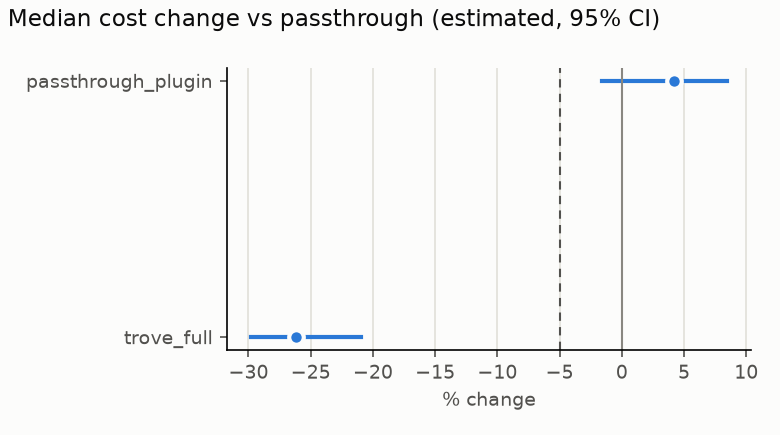
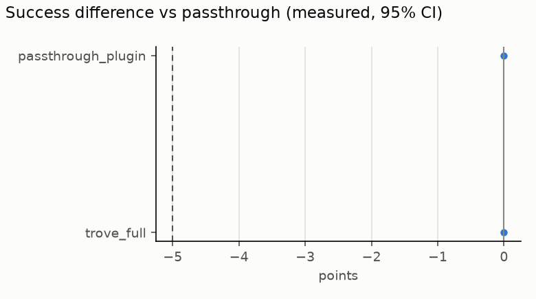
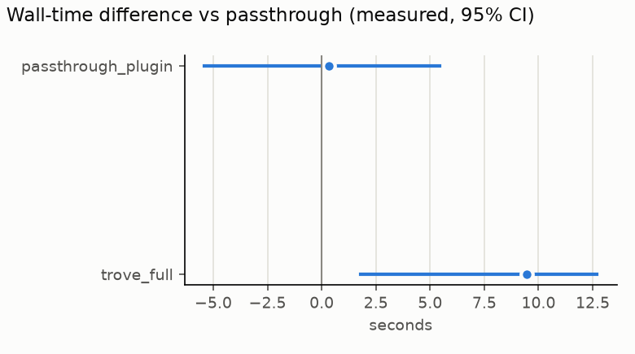

# Long sessions on Sonnet, every arm launched the same way: no optimization vs the Trove plugin vs the plugin + gateway + routing

Study `launch-3` · agent `claude_code` · model `claude-sonnet-5-5` · 30 task(s) · 90 run(s)

## Pre-registration

- Hypothesis: On long Claude Code sessions with Sonnet, with every arm launched the same way, the Trove plugin alone lowers the billed cost per session, and the plugin with the gateway and model routing lowers it further, in both cases without lowering the share of tasks that pass.

- Primary metric: `billed_cost_usd`; baseline: `passthrough`; conditions: `passthrough`, `passthrough_plugin`, `trove_full`
- Efforts: model default only; repeats: 2; order seed: 20261120
- Locked 2026-11-18T21:17:14+00:00 at commit `72caa71f53`, file hash `cfc8f2404fc4`. Every comparison below was registered before the first run; anything added afterwards is marked exploratory.

**How to read the numbers.** Pass/fail, wall time and token counts are *measured*. Cost is *estimated*: list price applied to the usage the gateway recorded for each request, using the same source for every condition (`recorded` basis). It is not an invoice. Two cost changes are shown against the baseline. The *total cost change* (total treated cost over total baseline cost) is the figure the decision rule uses, with its interval at the rule's confidence level. The *median cost change* is the typical per-pair change, for context. Both intervals come from a bootstrap that resamples whole tasks, because repeats of one task are not independent.

## Decisions

Rule: ship only if, over at least **30** pairs against `passthrough`, the 98% interval of the cost change is entirely at or below **-5%**, success does not fall by more than **5 points** (interval lower bound), and the primary p-value is below **0.025** after Holm correction.

| Condition | Pairs | Total cost change, est. (rule CI) | Median cost change, est. (CI) | Success diff, pts (CI) | Median latency diff | p (primary, adj.) | Verdict |
|---|---:|---|---|---|---|---|---|
| `passthrough_plugin` | 30 | +3.5% (-0.6%, +7.7%) | +4.2% (-1.6%, +8.5%) | +0.0 (+0.0, +0.0) | +0.3s (-5.4s, +5.4s) | 0.067, 0.067 | DON'T SHIP |
| `trove_full` | 30 | -25.3% (-29.2%, -21.4%) | -26.2% (-29.8%, -21.0%) | +0.0 (+0.0, +0.0) | +9.4s (+1.8s, +12.7s) | 0.000, 0.000 | SHIP |

- `passthrough_plugin`: Even the best case saves less than 5% (CI lower bound -0.6%).
- `trove_full`: Cost fell by at least 5% (CI upper bound -21.4%) and success did not drop by more than 5 points (CI lower bound +0.0).

## Per condition

| Condition | Runs | Excluded | Mean cost (est.) | Median cost (est.) | Success rate (95% CI) |
|---|---:|---:|---:|---:|---|
| `passthrough` | 30 | 0 | $0.1194 | $0.1114 | 100% (100%, 100%) |
| `passthrough_plugin` | 30 | 0 | $0.1236 | $0.1183 | 100% (100%, 100%) |
| `trove_full` | 30 | 0 | $0.0892 | $0.0829 | 100% (100%, 100%) |

## Charts







## Data quality

| Run | Status | Note |
|---|---|---|
| long-py-affine-cipher__trove_full__s0 | ok | agent's own cost estimate differs from the gateway's by 195% |
| long-py-beer-song__trove_full__s0 | ok | agent's own cost estimate differs from the gateway's by 184% |
| long-py-bottle-song__trove_full__s0 | ok | agent's own cost estimate differs from the gateway's by 193% |
| long-py-bowling__trove_full__s0 | ok | agent's own cost estimate differs from the gateway's by 276% |
| long-py-connect__trove_full__s0 | ok | agent's own cost estimate differs from the gateway's by 181% |
| long-py-dominoes__trove_full__s0 | ok | agent's own cost estimate differs from the gateway's by 197% |
| long-py-dot-dsl__trove_full__s0 | ok | agent's own cost estimate differs from the gateway's by 203% |
| long-py-food-chain__trove_full__s0 | ok | agent's own cost estimate differs from the gateway's by 233% |
| long-py-forth__trove_full__s0 | ok | agent's own cost estimate differs from the gateway's by 194% |
| long-py-go-counting__trove_full__s0 | ok | agent's own cost estimate differs from the gateway's by 233% |
| long-py-grade-school__trove_full__s0 | ok | agent's own cost estimate differs from the gateway's by 134% |
| long-py-grep__trove_full__s0 | ok | agent's own cost estimate differs from the gateway's by 188% |
| long-py-hangman__trove_full__s0 | ok | agent's own cost estimate differs from the gateway's by 188% |
| long-py-paasio__trove_full__s0 | ok | agent's own cost estimate differs from the gateway's by 254% |
| long-py-phone-number__trove_full__s0 | ok | agent's own cost estimate differs from the gateway's by 187% |
| long-py-pig-latin__trove_full__s0 | ok | agent's own cost estimate differs from the gateway's by 253% |
| long-py-poker__trove_full__s0 | ok | agent's own cost estimate differs from the gateway's by 188% |
| long-py-pov__trove_full__s0 | ok | agent's own cost estimate differs from the gateway's by 178% |
| long-py-react__trove_full__s0 | ok | agent's own cost estimate differs from the gateway's by 207% |
| long-py-rest-api__trove_full__s0 | ok | agent's own cost estimate differs from the gateway's by 258% |
| long-py-robot-name__trove_full__s0 | ok | agent's own cost estimate differs from the gateway's by 186% |
| long-py-scale-generator__trove_full__s0 | ok | agent's own cost estimate differs from the gateway's by 241% |
| long-py-sgf-parsing__trove_full__s0 | ok | agent's own cost estimate differs from the gateway's by 181% |
| long-py-transpose__trove_full__s0 | ok | agent's own cost estimate differs from the gateway's by 173% |
| long-py-tree-building__trove_full__s0 | ok | agent's own cost estimate differs from the gateway's by 228% |
| long-py-two-bucket__trove_full__s0 | ok | agent's own cost estimate differs from the gateway's by 187% |
| long-py-variable-length-quantity__trove_full__s0 | ok | agent's own cost estimate differs from the gateway's by 225% |
| long-py-wordy__trove_full__s0 | ok | agent's own cost estimate differs from the gateway's by 232% |
| long-py-zebra-puzzle__trove_full__s0 | ok | agent's own cost estimate differs from the gateway's by 224% |
| long-py-zipper__trove_full__s0 | ok | agent's own cost estimate differs from the gateway's by 173% |

## Versions (pinned for reproduction)

```json
{
  "agent": "claude_code",
  "agent_launch_mode": "full",
  "agent_version_pinned": "2.1.319",
  "agent_version_reported": "2.1.319 (Claude Code)",
  "config_sha256": "6b03a0bcd5624161aed0c7adc4e679040a0d48af35ee72b17e72273b1628bbb9",
  "dataset_commits": [
    "7e0611e77b54e2dea774cdc0aa00cf9f7ed6144f"
  ],
  "docker_arch": "amd64",
  "fake_agent": false,
  "image_ids": {
    "long-py-affine-cipher": "sha256:8d580bb6c0a6bca5d471bd652a08c7d12d910f896752527fc798da762b5a891a",
    "long-py-beer-song": "sha256:8d580bb6c0a6bca5d471bd652a08c7d12d910f896752527fc798da762b5a891a",
    "long-py-bottle-song": "sha256:8d580bb6c0a6bca5d471bd652a08c7d12d910f896752527fc798da762b5a891a",
    "long-py-bowling": "sha256:8d580bb6c0a6bca5d471bd652a08c7d12d910f896752527fc798da762b5a891a",
    "long-py-connect": "sha256:8d580bb6c0a6bca5d471bd652a08c7d12d910f896752527fc798da762b5a891a",
    "long-py-dominoes": "sha256:8d580bb6c0a6bca5d471bd652a08c7d12d910f896752527fc798da762b5a891a",
    "long-py-dot-dsl": "sha256:8d580bb6c0a6bca5d471bd652a08c7d12d910f896752527fc798da762b5a891a",
    "long-py-food-chain": "sha256:8d580bb6c0a6bca5d471bd652a08c7d12d910f896752527fc798da762b5a891a",
    "long-py-forth": "sha256:8d580bb6c0a6bca5d471bd652a08c7d12d910f896752527fc798da762b5a891a",
    "long-py-go-counting": "sha256:8d580bb6c0a6bca5d471bd652a08c7d12d910f896752527fc798da762b5a891a",
    "long-py-grade-school": "sha256:8d580bb6c0a6bca5d471bd652a08c7d12d910f896752527fc798da762b5a891a",
    "long-py-grep": "sha256:8d580bb6c0a6bca5d471bd652a08c7d12d910f896752527fc798da762b5a891a",
    "long-py-hangman": "sha256:8d580bb6c0a6bca5d471bd652a08c7d12d910f896752527fc798da762b5a891a",
    "long-py-paasio": "sha256:8d580bb6c0a6bca5d471bd652a08c7d12d910f896752527fc798da762b5a891a",
    "long-py-phone-number": "sha256:8d580bb6c0a6bca5d471bd652a08c7d12d910f896752527fc798da762b5a891a",
    "long-py-pig-latin": "sha256:8d580bb6c0a6bca5d471bd652a08c7d12d910f896752527fc798da762b5a891a",
    "long-py-poker": "sha256:8d580bb6c0a6bca5d471bd652a08c7d12d910f896752527fc798da762b5a891a",
    "long-py-pov": "sha256:8d580bb6c0a6bca5d471bd652a08c7d12d910f896752527fc798da762b5a891a",
    "long-py-react": "sha256:8d580bb6c0a6bca5d471bd652a08c7d12d910f896752527fc798da762b5a891a",
    "long-py-rest-api": "sha256:8d580bb6c0a6bca5d471bd652a08c7d12d910f896752527fc798da762b5a891a",
    "long-py-robot-name": "sha256:8d580bb6c0a6bca5d471bd652a08c7d12d910f896752527fc798da762b5a891a",
    "long-py-scale-generator": "sha256:8d580bb6c0a6bca5d471bd652a08c7d12d910f896752527fc798da762b5a891a",
    "long-py-sgf-parsing": "sha256:8d580bb6c0a6bca5d471bd652a08c7d12d910f896752527fc798da762b5a891a",
    "long-py-transpose": "sha256:8d580bb6c0a6bca5d471bd652a08c7d12d910f896752527fc798da762b5a891a",
    "long-py-tree-building": "sha256:8d580bb6c0a6bca5d471bd652a08c7d12d910f896752527fc798da762b5a891a",
    "long-py-two-bucket": "sha256:8d580bb6c0a6bca5d471bd652a08c7d12d910f896752527fc798da762b5a891a",
    "long-py-variable-length-quantity": "sha256:8d580bb6c0a6bca5d471bd652a08c7d12d910f896752527fc798da762b5a891a",
    "long-py-wordy": "sha256:8d580bb6c0a6bca5d471bd652a08c7d12d910f896752527fc798da762b5a891a",
    "long-py-zebra-puzzle": "sha256:8d580bb6c0a6bca5d471bd652a08c7d12d910f896752527fc798da762b5a891a",
    "long-py-zipper": "sha256:8d580bb6c0a6bca5d471bd652a08c7d12d910f896752527fc798da762b5a891a"
  },
  "model": "claude-sonnet-5-5",
  "pricing_data_version": "2026-11-12.1",
  "trove_binary_sha256": "ffdc94ee0fbfe6c3811dd66f33965db6754ac804cd3e50e3b162304358466da0",
  "trove_commit": "42f72ca57e7bc9ce8e1adfa11fa0839008e6b8f8",
  "trove_dirty": false
}
```

## Data use

Transcripts of these runs, if kept, are for analysis and debugging only. No model is trained on anything produced by these runs. Task content belongs to its upstream projects (see `bench/LICENSES.md`); this report publishes only task IDs and aggregates.
